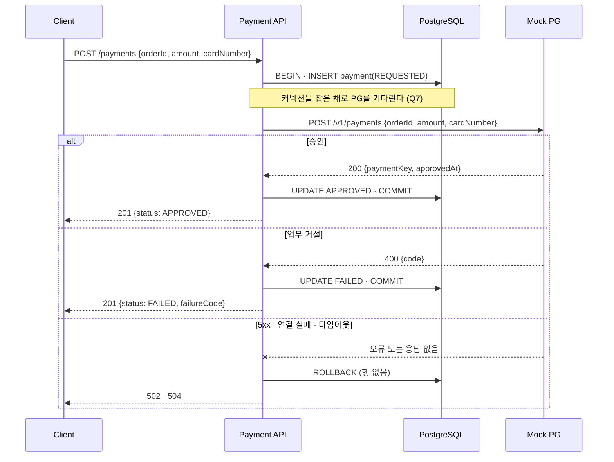

# ADR-000: 결제 도메인과 평범한 구현 (baseline)

- 상태: 채택 (Accepted) — 2026-11-18 구현 · 검증 끝(코드 커밋 58ca09d)
- 날짜: 2026-11-18
- 성격: **베이스라인**. 정합성 장치 없이 "기능이 되는" 가장 평범한 결제 구현을 만든다. ADR-001부터는 이 베이스라인에서 문제를 관측하고 하나씩 해결한다.
- 아키텍처: 레이어드(api / service / domain) + DDD 애그리거트 + 바깥 PG 어댑터(infra)

## 1. 왜 베이스라인부터 만드는가

해법을 먼저 넣으면 ADR의 "선택 이유"가 추론으로만 남는다. 이 랩은 seat-reservation-lab과 같은 순서를 따른다.

```
ADR-000 평범한 구현 ──▶ 부하 · 장애 주입으로 문제 관측 ──▶ ADR-00X: 선택지별 실험 · 실측 ──▶ 해결 확인
   (기능은 됨)            (수치로 깨짐을 보임)               (같은 시나리오 · 같은 합격 기준)
```

베이스라인 원칙:

- **평범할 것**: 처음 결제를 붙이는 개발자가 짜는 코드. `@Transactional` 안에서 **저장 → PG 호출 → 결과 반영**. 일부러 망가뜨린 코드가 아니라, 정상 경로에서는 올바르게 동작하는 코드다.
- **문제를 가리지 않을 것**: 멱등키 · 주문번호 유니크 제약 · 락 · 아웃박스 · 재시도 · 결과 불명 처리 · 웹훅 · 정산 대조를 넣지 않는다. 스키마에는 PK와 FK만 둔다.
- **mock PG도 최소일 것**: 실제 PG가 당연히 하는 일(결제 기록 · 조회 · 주문번호 중복 거절)만 한다. 측정 하네스용 장치(비교용 원장 내보내기 · 시드로 재현되는 장애 주입 · 관리 API)는 **필요가 드러나는 ADR에서** 넣는다 — 왜 필요한지를 이 랩에서 관측하기 위해서다.

## 2. 도메인 모델

```
payment (결제)                       ← 가맹점 주문번호 하나에 대한 결제 시도 1건
  1
  │
  0..N
payment_cancel (취소 내역)            ← 전체 · 부분 취소 1건마다 1행
```

| 결정 | 내용 | 이유 |
|------|------|------|
| 결제 단독 | 주문 · 재고 없이 가맹점 주문번호(`orderId`) + 금액으로 결제한다 | 주문 · 재고 · 보상은 03 order-saga-lab의 몫. 이 랩은 "우리 DB ↔ PG"의 일치만 본다 |
| 결제 1행 = 시도 1건 | 같은 `orderId`로 다시 요청하면 **새 행**이 생긴다 | 베이스라인은 중복을 막지 않는다. 한 주문번호에 몇 행이 쌓이는지가 Q1의 관측 대상이다 |
| 금액 | 원 단위 정수(`Long`) | 소수 · 통화 변환은 범위 밖 |
| 취소 내역 분리 | 부분 취소가 여러 번 올 수 있어 취소마다 행을 남긴다 | 누적 취소액만 두면 취소 한 건 단위로 볼 수 없다. 다만 베이스라인의 취소 행에는 PG 쪽 취소 식별자와 PG 취소 시각이 없다. 같은 금액의 부분 취소가 여러 번이면 우리 행과 PG 취소를 짝지을 수 없어서, 정산 대조(Q5)에서 어느 취소에서 불일치가 났는지는 아직 가릴 수 없다(§9) |
| 카드 번호 | 요청으로 받아 PG에 넘기기만 하고 **저장하지 않는다** | 결제 수단 보관은 범위 밖. mock PG의 거절 시험 카드에만 쓴다 |
| 사용자 | 헤더 `X-User-Id`(인증은 범위 밖) | Q1(같은 사용자의 10회 클릭)을 사용자 단위로 세기 위해 저장한다 |

### 2.1 애그리거트

```
┌──────────────────────────────────┐
│ Payment (루트)                    │
│ orderId · userId · amount         │
│ status · paymentKey               │
│ canceledAmount                    │
│ failureCode · failureMessage      │
│ └─ PaymentCancel (내부, 0..N)     │
│      amount · reason · canceledAt │
└──────────────────────────────────┘
```

| 애그리거트 | 루트 | 내부 | 지키는 불변식 |
|-----------|------|------|--------------|
| **Payment** | `Payment` | `PaymentCancel` | ① 전이는 §3 표대로만 ② `canceledAmount` = Σ 취소 내역 금액 ≤ `amount` ③ `CANCELED` ⇔ `canceledAmount = amount` · `PARTIALLY_CANCELED` ⇔ 0 < `canceledAmount` < `amount` ④ `APPROVED` 이상이면 `paymentKey`가 있다 ⑤ `FAILED`면 `failureCode`가 있고 취소 내역이 없다 |

- 취소 내역은 결제 루트를 통해서만 생긴다(`payment.cancel(...)`). 취소 전용 리포지토리는 없다.
- 애그리거트가 규칙을 가져도 **동시성 문제는 남는다**. 결제 행에는 버전 열도 잠금도 없다. 두 취소 요청이 같은 스냅샷을 읽으면 둘 다 검사를 통과하고, 각자 `canceledAmount`를 스냅샷 값에 더해 덮어쓴다. 나중에 커밋한 쪽이 앞쪽 증가분을 지운다(갱신 유실). 취소 내역 행은 INSERT라 둘 다 남는다. 그래서 불변식 ②가 DB에서 깨진다. 예를 들어 10,000원 결제에 3,000원 취소 두 건이 동시에 오면, PG는 6,000원을 취소하고 취소 행 합계도 6,000원인데 `canceled_amount`는 3,000원이다. 5,000원 두 건이면 PG는 전액 취소인데 우리는 `PARTIALLY_CANCELED`로 남고, 남은 금액 취소는 PG가 거절해(409) 이 결제는 닫히지 않는다. PG는 초과 취소만 막고 이 경우는 막지 못한다. 베이스라인은 이를 막지 않는다(§9).

## 3. 상태 전이

```
                PG 승인 성공
 REQUESTED ───────────────────▶ APPROVED ──부분 취소──▶ PARTIALLY_CANCELED ──남은 금액 전부 취소──▶ CANCELED
     │                              │                     │  ▲                                      ▲
     │ PG 업무 거절                  │                     └──┘ 부분 취소(남은 금액 > 0)              │
     ▼                              └──────────────────────── 전체 취소 ──────────────────────────────┘
  FAILED
```

| 전이 | 트리거 | 베이스라인 절차 (한 트랜잭션) |
|------|--------|--------------------------|
| 생성 → 승인 · 실패 | `POST /payments` | `Payment.request(...)`(REQUESTED) 저장 → **트랜잭션 안에서** PG 승인 호출 → 성공이면 `approve(paymentKey, approvedAt)`, 업무 거절이면 `fail(code, message)` → 커밋 |
| 취소 | `POST /payments/{id}/cancel` | 결제 로드 → `assertCancelable(cancelAmount, reason)` → **트랜잭션 안에서** PG 취소 호출 → 성공이면 `cancel(amount, reason, canceledAt)` → 커밋 |

- `REQUESTED`는 도메인에는 있지만 베이스라인에서는 **커밋되어 보이는 일이 없다**. 저장과 PG 호출이 한 트랜잭션이라, 커밋 시점에는 이미 `APPROVED` 또는 `FAILED`다.
- **PG 기술 실패**(연결 실패 · 5xx · 읽기 타임아웃)는 예외가 되어 **트랜잭션 전체가 롤백된다** — 결제 행이 남지 않는다. PG가 실제로는 승인했어도(응답 유실) 우리 DB에는 흔적이 없다. 이것이 Q2 · Q6의 베이스라인 모습이다(§8).
- PG 업무 거절(카드 거절 · 잔액 부족 · 주문번호 중복)은 예외가 아니라 결과다 — `FAILED`로 커밋한다.
- 시각은 애플리케이션 `Clock`에서 얻는다(테스트에서 고정 가능).

### 3.1 승인 시퀀스



## 4. 규칙 · 설정

| 규칙 | 값 | 설정 |
|------|----|------|
| PG 연결 타임아웃 | 3초 (README Load Profile) | `payment.pg.connect-timeout` |
| PG 읽기 타임아웃 | 10초 (README Load Profile) | `payment.pg.read-timeout` |
| PG 주소 | `http://localhost:8110`(로컬) · compose 망 `http://mock-pg:8110` | `payment.pg.base-url` |
| 앱 포트 | 8102 (상위 README) | `server.port` |
| 취소 금액 생략 | 남은 금액 전부 | — |

## 5. DB 스키마 (Flyway `V1__init.sql`)

```sql
CREATE TABLE payment (
    id               BIGSERIAL    PRIMARY KEY,
    order_id         VARCHAR(64)  NOT NULL,
    user_id          BIGINT       NOT NULL,
    amount           BIGINT       NOT NULL,
    canceled_amount  BIGINT       NOT NULL,
    status           VARCHAR(30)  NOT NULL,
    payment_key      VARCHAR(64),
    failure_code     VARCHAR(50),
    failure_message  VARCHAR(200),
    requested_at     TIMESTAMPTZ  NOT NULL,
    approved_at      TIMESTAMPTZ,
    updated_at       TIMESTAMPTZ  NOT NULL
);

CREATE TABLE payment_cancel (
    id           BIGSERIAL    PRIMARY KEY,
    payment_id   BIGINT       NOT NULL REFERENCES payment (id),
    amount       BIGINT       NOT NULL,
    reason       VARCHAR(200),
    canceled_at  TIMESTAMPTZ  NOT NULL
);
```

- 의도적으로 **없는 것**: `order_id` 유니크, `payment_key` 유니크 · 인덱스, `status` · 금액 CHECK, 조회용 인덱스, 낙관적 락 버전 컬럼. 인덱스 부재가 측정을 왜곡하면 해당 ADR에서 V2 이후로 추가하고 before/after를 기록한다.

## 6. API (앱)

사용자 식별은 헤더 `X-User-Id`. 오류 본문은 `{code, message}`.

- 오류 본문은 표 밖 오류에도 같은 모양이다: Spring MVC 표준 오류(없는 경로 404 · 메서드 405 등)는 그 상태 그대로 `code` = `HTTP_<상태>`(단 JSON이 아닌 Content-Type 415는 §6.1대로 `400 INVALID_REQUEST` · 응답 형식 협상 실패(406)는 본문을 보장하지 않는다), 처리하지 못한 예외(예: 커넥션 풀 대기 초과)는 `500 INTERNAL_ERROR`.
- `502 PG_UNAVAILABLE` · `504 PG_TIMEOUT` · `500`의 `message`는 고정 문구다. 원인 예외(내부 PG 주소 · paymentKey가 든 URL)는 응답에 싣지 않고 서버 로그(WARN · ERROR)에만 남긴다.
- 카드번호는 요청 · 명령 객체의 문자열 표현(`toString`)에도 넣지 않는다(로그 유출 방지).

| 메서드 | 경로 | 요청 | 성공 | 실패 |
|--------|------|------|------|------|
| POST | `/payments` | `{orderId, amount, cardNumber}` | `201` 결제 응답(`status` = `APPROVED` 또는 `FAILED`) | `400 INVALID_REQUEST`(§6.1 입력 검증 위반 · X-User-Id 없음 · 숫자 아님) · `502 PG_UNAVAILABLE`(PG 5xx · 연결 실패) · `504 PG_TIMEOUT`(읽기 타임아웃) |
| POST | `/payments/{id}/cancel` | `{cancelAmount?, reason?}` | `200` 결제 응답 | `400 INVALID_REQUEST`(§6.1 입력 검증 위반) · `404 PAYMENT_NOT_FOUND` · `409 PAYMENT_NOT_CANCELABLE`(`APPROVED` · `PARTIALLY_CANCELED` 아님) · `409 CANCEL_AMOUNT_EXCEEDED`(남은 금액 초과) · `409 PG_REJECTED`(PG 업무 거절) · `502` · `504` |
| GET | `/payments/{id}` | — | `200` 결제 응답 | `404 PAYMENT_NOT_FOUND` |

결제 응답: `{paymentId, orderId, userId, amount, canceledAmount, status, paymentKey, failureCode, failureMessage, requestedAt, approvedAt, cancels: [{amount, reason, canceledAt}]}`.

- 승인 요청에서 PG 업무 거절은 **201 + `FAILED`**다 — 결제 시도라는 자원은 만들어졌고, 결과가 실패다.
- 취소 요청에서 PG 업무 거절(PG 쪽에선 이미 취소됨 등)은 **409 `PG_REJECTED`**이고 우리 상태는 바뀌지 않는다(롤백).
- 취소 검사는 PG 호출 **전에** 우리 스냅샷으로 한다(check-then-act). 우리가 통과시켜도 PG가 거절할 수 있다.
- 앱은 PG에 **언제나 취소 금액을 명시해서** 보낸다(생략 요청이면 우리 스냅샷의 남은 금액 = `amount − canceledAmount`).
- 앱 상태는 **도메인 계산으로 정한다**(승인 응답의 `paymentKey` · `approvedAt`과 우리가 보낸 취소 금액만 쓴다). PG 응답의 `status` · `balanceAmount`로 우리 상태를 덮어쓰거나 비교하지 않는다 — 비교는 정합성 검증기(ADR-001)의 몫이다. 이름 대응(참고): PG `DONE` ↔ 앱 `APPROVED` · `PARTIAL_CANCELED` ↔ `PARTIALLY_CANCELED` · `CANCELED` ↔ `CANCELED`.
- PG 업무 거절 메시지는 `failure_message`(200자)에 앞 200자만, 거절 코드는 `failure_code`(50자)에 앞 50자만 저장한다. 50자를 넘는 코드는 잘린 채 저장되므로 PG 코드와 비교할 때 주의한다.
- PG 오류 분류: 연결 실패 · **연결 타임아웃** · 5xx · 성공 응답에 `paymentKey` · `approvedAt`이 없음 · `paymentKey`가 64자(DB 열 길이)를 넘음 = `502 PG_UNAVAILABLE` / 읽기 타임아웃 = `504 PG_TIMEOUT` / 4xx = 업무 거절(본문 `code`를 못 읽으면 `HTTP_<상태>`).

- 검사 순서(앞 단계가 우선한다): 입력 검증(400) → 결제 존재(404) → 상태(`PAYMENT_NOT_CANCELABLE`) → 금액(`CANCEL_AMOUNT_EXCEEDED`) → PG 호출. 앞 단계에서 거부되면 PG를 부르지 않고 상태도 바뀌지 않는다.

### 6.1 입력 검증 (위반 = `400 INVALID_REQUEST` · PG를 부르지 않는다)

| 필드 | 규칙 |
|------|------|
| `X-User-Id` | **승인에서만** 필수 · 양의 정수(1.5 · 문자 = 400). 취소 · 조회는 받지 않는다(인증 · 소유 검사는 범위 밖) |
| `orderId` | 영문 · 숫자 · `_` · `-`만, 1~64자 (DB `VARCHAR(64)`). PG 주문번호 조회 경로(`/orders/{orderId}`)에 그대로 넣을 수 있는 문자만 받는다. 도메인 `Payment.request`도 같은 규칙으로 검사한다 |
| `amount` | **JSON 정수**만(1.5 · 문자열 "1000" = 400) · 1 이상 |
| `cardNumber` | 공백 아님 · 1~32자 (저장하지 않음) |
| `cancelAmount` | 생략 또는 `null` = 남은 금액 전부 · 있으면 JSON 정수 · 1 이상 |
| `reason` | 생략 가능 · 있으면 200자 이하 (DB `VARCHAR(200)`). 도메인 `assertCancelable`도 PG 호출 전에 같은 길이를 검사한다(API 밖 진입점이 PG 취소 뒤 커밋에서 실패하지 않게) |
| 경로 `{id}` | 양의 정수 · Long 범위 (아니면 400) |
| 본문 | JSON으로 읽을 수 없으면 400 |

## 7. mock PG (`mock-pg` 하위 모듈 · 포트 8110)

실제 PG를 대신하는 **별도 프로세스**(HTTP). 앱은 네트워크 너머로 부른다 — 그래야 타임아웃 · 응답 유실 · 지연 전파(Q2 · Q6 · Q7)가 실제로 생긴다.

| 메서드 | 경로 | 요청 | 성공 | 업무 거절 |
|--------|------|------|------|----------|
| POST | `/v1/payments` | `{orderId, amount, cardNumber}` | `200 {paymentKey, orderId, status: DONE, totalAmount, balanceAmount, approvedAt, cancels: []}` | `400 {code: CARD_DECLINED · INSUFFICIENT_FUNDS · DUPLICATED_ORDER_ID · INVALID_REQUEST}` |
| POST | `/v1/payments/{paymentKey}/cancel` | `{cancelAmount?, cancelReason?}` — `cancelAmount` 생략 = 남은 금액(`balanceAmount`) 전부 | `200` 결제(`status` = `PARTIAL_CANCELED` 또는 `CANCELED` · `balanceAmount` 감소 · `cancels` 추가) | `404 NOT_FOUND_PAYMENT` · `400 ALREADY_CANCELED` · `400 EXCEED_CANCEL_AMOUNT` |
| GET | `/v1/payments/{paymentKey}` | — | `200` 결제 | `404 NOT_FOUND_PAYMENT` |
| GET | `/v1/payments/orders/{orderId}` | — | `200` 결제 | `404 NOT_FOUND_PAYMENT` |

- **결제 기록**: 프로세스 메모리. **재기동하면 사라진다** — 실제 PG와 다른 점이고, 정합성 판정(ADR-001)에서 문제가 되면 그때 다룬다.
- **주문번호 중복**: 설정 `mockpg.reject-duplicate-order-id`(기본 `true`) — 실제 PG처럼 같은 `orderId`의 두 번째 승인을 `DUPLICATED_ORDER_ID`로 거절한다. 판정은 원자적이다(동시 요청 10건이어도 승인은 1건). `false`면 같은 `orderId`로 여러 번 승인한다(이중 승인 관측용). 주문번호 조회는 그 주문번호의 **가장 최근 승인**을 돌려준다.
- **업무 거절 기록**: 거절된 승인 시도(카드 거절 · 잔액 부족 · 주문번호 중복 · 입력 오류)는 **기록하지 않는다** — 조회되지 않고(404), 주문번호 중복 판정에도 들어가지 않는다(같은 orderId로 다시 승인하면 된다). PG `INVALID_REQUEST` = `amount` ≤ 0 · `orderId` 비어 있음 · `cardNumber` 비어 있음.
- **mock PG 판정 순서**: 승인 = 입력 검증(`INVALID_REQUEST`) → 시험 카드 → 주문번호 중복. 취소 `cancelAmount` ≤ 0 = `400 INVALID_REQUEST`.
- **거절 시험 카드**: `4000000000000002` → `CARD_DECLINED` · `4000000000009995` → `INSUFFICIENT_FUNDS`. 그 밖의 번호는 승인.
- **장애 주입**(승인 · 취소에만 — 조회는 주입 없음 · 기본값 모두 0 · 기동 설정으로만 바꾼다 · **시드 없는 무작위**):

| 설정 | 의미 |
|------|------|
| `mockpg.fault.latency-min-ms` · `latency-max-ms` | 응답 전 지연 ~ U[min, max] |
| `mockpg.fault.error-rate` | 이 확률로 **처리하지 않고** `500` |
| `mockpg.fault.drop-rate` | 이 확률로 **처리(승인 · 취소 기록 — 업무 거절 결과 포함)한 뒤** `drop-hold-ms` 동안 응답하지 않는다(앱 읽기 타임아웃보다 길게 — 응답 유실) |
| `mockpg.fault.drop-hold-ms` | 기본 15,000 |

- 주입은 승인과 취소에 똑같이 걸리므로, 블랙박스 테스트로는 '승인은 되고 취소만 실패'를 만들 수 없다. 앱의 취소 경로 502 · 504 · 롤백은 구현 테스트(가짜 `PgClient`)로 확인한다.
- 시드가 없으므로 같은 장애를 다시 만들 수 없다. 이것도 베이스라인의 일부다 — 재현이 필요해지면 그 ADR에서 결정적 주입을 넣는다.

## 8. 코드 구조

```
payment-consistency-lab
├── src/main/kotlin/com/jun/labs/paymentconsistency
│   ├── api/                 컨트롤러 · 요청/응답 DTO · 예외 → HTTP 매핑
│   ├── service/             UseCase 인터페이스 · 커맨드/결과
│   │   └── impl/            UseCase 구현 — 로드 → PG 호출 → 도메인 메서드 → 저장 (조율만)
│   ├── domain/              Payment · PaymentCancel · PaymentStatus · 도메인 예외(ErrorCode)
│   │   └── repository/      PaymentRepository (Spring Data JPA)
│   └── infra/pg/            PgClient 인터페이스 · RestClient 구현 · PG 오류 → 결과/예외 변환
├── src/main/resources/db/migration/V1__init.sql
└── mock-pg/                 하위 모듈 (Spring Boot · 메모리 저장 · 장애 주입)
```

- 의존 방향: `api → service → domain`, `service → infra/pg`(인터페이스). 도메인은 PG를 모른다.
- 쿼리는 쓰지 않는다. 파생 쿼리 메서드와 애그리거트 저장만.

## 9. 베이스라인이 일부러 남겨 둔 약점 → 가설 ADR

번호는 관측 순서대로 붙인다(ADR-001만 먼저 정한다).

| 약점 (베이스라인에서 예상되는 모습) | README Q | 가설 ADR |
|------|---|---------|
| 합격 기준이 없다 — "우리 DB와 PG가 일치하는가"를 셀 도구가 없다. PG 쪽 사실을 꺼낼 길(원장 내보내기)과 같은 장애를 다시 만드는 길(결정적 주입)이 여기서 필요해질 것이다 | 전체 | **ADR-001** 정합성 판정 · 관측 하네스 |
| 같은 사용자의 10회 클릭 → 같은 `orderId` 행이 여러 개 생긴다(PG 거절로 `FAILED` 9개). PG 중복 거절을 끄면 이중 승인 | Q1 | 중복 요청 방지(멱등키 · 유니크 제약 · PG 의존 비교) |
| PG 승인 성공 + 우리 커밋 실패 → PG에만 승인이 있다(행 없음) | Q2 | PG 호출과 DB 커밋의 분리 · 결과 확인 |
| 커밋 직후 서버 다운 → 클라이언트는 결과를 모르고 다시 요청 → 주문번호 중복 거절 | Q3 | 〃 · 클라이언트 재요청 계약 |
| 이벤트가 없다 — 아웃박스 · 웹훅이 생긴 뒤에야 중복 소비가 생긴다 | Q4 | 아웃박스 · 웹훅 도입 ADR에서 함께 |
| 정산 대조가 없다 — 불일치를 찾을 수 없다 | Q5 | 정산 보정 배치 |
| PG 읽기 타임아웃 → 롤백, 행 없음. PG가 승인했는지 모른 채 끝난다 | Q6 | 결과 불명 처리(조회 API · 웹훅 · 상태 `UNKNOWN`) |
| PG 지연 동안 DB 커넥션을 잡는다 → 지연이 커넥션 풀을 고갈시키고 PG와 무관한 조회까지 느려진다 | Q7 | 트랜잭션 밖 PG 호출 · 타임아웃 · 벌크헤드 · 서킷 |
| 두 취소 요청이 같은 스냅샷을 읽는다 → 갱신 유실로 `canceled_amount` ≠ 취소 행 합계, PG와 상태가 달라진다(§2.1). PG는 초과 취소만 막고 이 경우는 막지 못한다 | (Q5 연관) | 취소 동시성 |
| 취소 행에 PG 취소 식별자 · PG 취소 시각이 없다 → 같은 금액의 부분 취소가 여러 번이면 우리 행과 PG 취소를 짝지을 수 없다 | Q5 | 정산 대조 ADR 전에 취소 식별자 저장(PG 응답 · mock PG 기록) |
| 취소에는 요청 상태가 없다(성공한 뒤에만 행이 생김) → PG 취소 성공 + 우리 롤백(타임아웃 등)이면 PG에만 취소가 남는다. 다시 취소를 보내면 결과는 금액에 달렸다. 보낸 금액이 PG의 남은 잔액 이하면 PG에서 한 번 더 취소된다(이중 취소). 넘으면 PG가 거절한다(409). 금액을 생략하면 앱은 롤백돼 그대로인 우리 쪽 남은 금액을 보내므로, 앞선 취소가 일부라도 PG에 남아 있으면 PG 잔액을 넘어 409다 | Q2 · Q6 | 결과 불명 처리 ADR에서 취소 모델 확장(요청 · 완료 · 실패 · 불명 상태, 불변식 ②·③은 완료된 취소의 합으로 재정의) |

## 10. 검증

- 기능 테스트(Testcontainers PostgreSQL 16 · mock PG 실제 HTTP) · blind 테스트 · 로컬 compose 스모크(record 비교) · 듀얼 리뷰 — 결과는 작업 기록 `docs/plans/2026-11-18/adr-000-baseline/log.md`.

### 10.1 결과 (2026-11-18)

- 테스트: 앱 14클래스 90개(blind 6클래스 포함) · mock-pg 5클래스 29개 — 실패 0.
- 로컬 compose 스모크(record 비교): 승인 → 조회 → 부분 취소 3,000 → 금액 생략 취소(7,000) → 재취소 409 · 거절 카드 201 FAILED · 입력 오류 400. DB(결제 2행 · 취소 2행)와 mock PG(잔액 0 · 취소 2건 · 거절 미기록)가 같았다.
- §9 약점이 실제로 드러나는지(가정 확인):
  - **Q7** — mock PG 지연 2초 · 동시 30건: DB 연결 10개(풀 전부)가 `idle in transaction`으로 PG를 기다렸다. 응답 p50 5.4초 · 최대 7.5초(PG 지연 2초에 커넥션 대기가 더해짐).
  - **Q2 · Q6** — 응답 유실 1.0: 앱은 10초 뒤 504, mock PG에는 4,200원 승인(DONE), 우리 DB에는 그 주문 행이 없다(롤백). 돈은 빠졌는데 우리는 모르는 결제가 베이스라인에서 그대로 생긴다.
- 리뷰에서 고친 것: 오류 본문에 내부 PG 주소 · 예외 원문이 나가던 것(5xx 고정 문구 · 원인은 로그) · 표 밖 오류 본문 모양 · 부호 붙은 숫자 · 카드번호 문자열 표현 · 테스트 공백(PG 미호출 증명 · 실제 HTTP의 취소 금액 명시).

